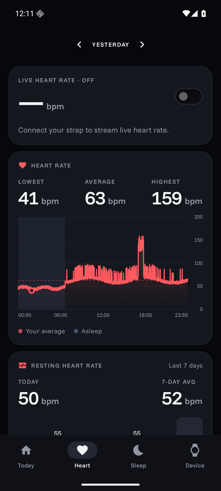

# OpenStrap

A private, open-source companion app for the **Amazfit Helio Strap**, built as a replacement for Zepp.

- **Local-first.** Health data lives in a database on your phone. The app doesn't use Zepp's cloud, any analytics or any trackers.
- **Modern.** It is built with Kotlin, Jetpack Compose and Material 3, and has a dark-first design with Funnel Display/Sans fonts.
- **Clean-room.** The protocol is implemented from written specs in [`docs/protocol/`](docs/protocol). Those specs were derived only from static analysis of the official app. No Gadgetbridge (AGPL) code was used.

| Today | Sleep | Heart |
|---|---|---|
|  |  |  |

*Screenshots use the sample data that debug builds can generate.*

## Status

| Feature | State |
|---|---|
| Pair with auth key, ECDH (B-163) auth, encrypted channel | Implemented, tested against a simulated strap |
| Battery, firmware version, time sync | Implemented |
| Live heart rate | Implemented |
| History sync: activity, sleep stages, HR, HRV, resting HR, SpO₂, stress | Implemented |
| Dashboard: Today / Heart / Sleep | Implemented |
| Export: CSV zip, Android Health Connect | Implemented |
| Firmware update (online check with your own Zepp token, or from a file) | Implemented, not yet tried on hardware |
| Workouts (protobuf summaries, GPS) | Not yet |
| Open energy score ("Reserve") | Planned |

⚠️ **None of this has run against a real strap yet.** Everything marked UNVERIFIED in the specs is a best guess, and those points are isolated in code comments. Use **Device → Diagnostics → copy** to capture a log when testing.

## Getting the auth key

The strap only accepts a first pairing that Zepp's server has signed. After that, every connection is local. So the setup is:

1. Pair the strap **once** with the Zepp app. A throwaway account with minimal profile data is enough.
2. Read the strap's `auth_key` from your Zepp account's device list (the [Gadgetbridge server-pairing guide](https://gadgetbridge.org/basics/pairing/huami-xiaomi-server/) explains how). It is 32 hex characters.
3. Uninstall Zepp. **Do not unbind the strap in Zepp**: that wipes the key on the strap.
4. In OpenStrap: **Device → Scan** (strap on its charger) → paste the key → **Pair**.

Treat the key like a password. Anyone who has it can connect to your strap.

## Building

Requires JDK 21 and the Android SDK (compileSdk 37).

```bash
./gradlew :protocol:test :app:testDebugUnitTest :app:assembleDebug
```

## Layout

- **`protocol/`**: a pure Kotlin/JVM module with no Android dependencies. It contains the B-163 ECDH, channel framing, AES/CRC session cipher, auth handshake, service codecs and the GDSP history fetch with its record parsers. A simulated strap tests it end to end.
- **`app/`**: the Android app. It covers the coroutine GATT client, `StrapManager` (connection lifecycle), `HistorySync`, Room storage, the Compose UI, and the Health Connect and CSV exporters.
- **`docs/protocol/`**: the clean-room specifications.

## License

Dual-licensed under [MIT](LICENSE-MIT) or [Apache-2.0](LICENSE-APACHE), at your option. The fonts are licensed under the SIL OFL 1.1 ([licenses/OFL-Funnel.txt](licenses/OFL-Funnel.txt)).

OpenStrap is not affiliated with Zepp Health or Amazfit.

## Network use

OpenStrap only goes online when you tap **Check for update** or **Download** on the Firmware screen. A check sends your Zepp app token, your user ID, and the strap's firmware version, hardware version and serial number to the update server you set. Health data is never uploaded.
