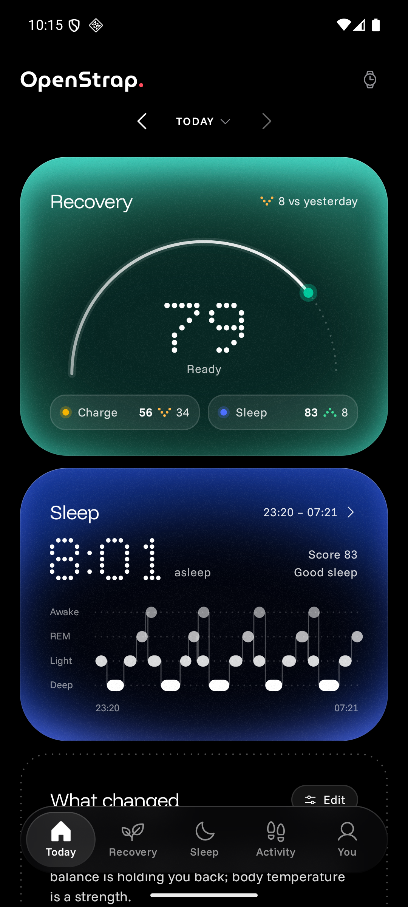
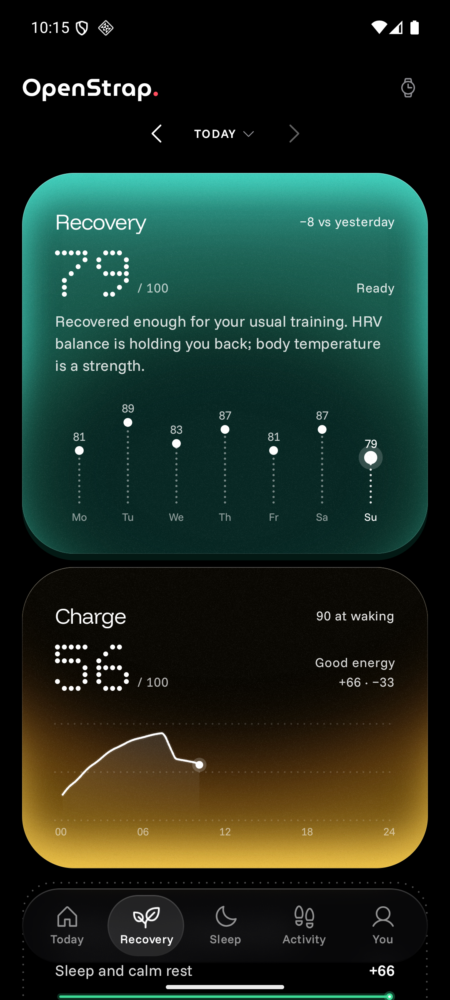
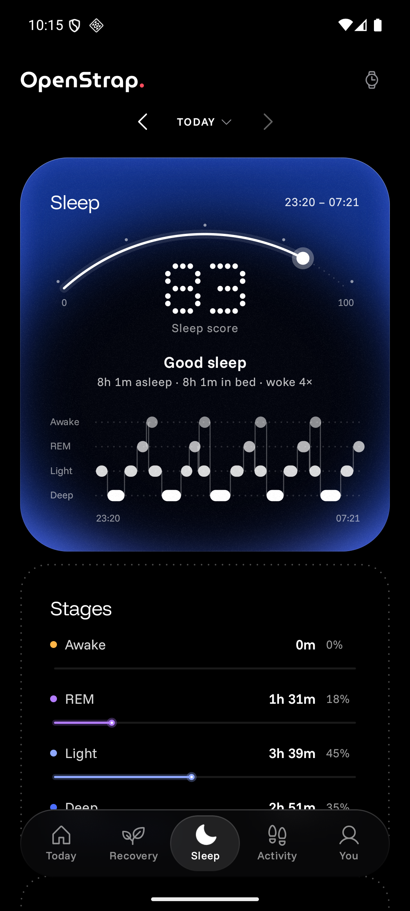
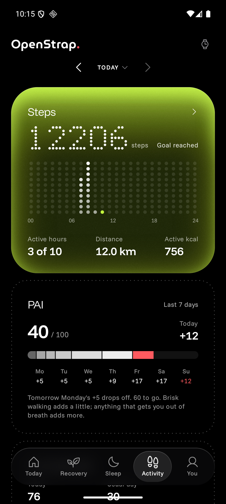

<h1>
  <picture>
    <source media="(prefers-color-scheme: dark)" srcset="docs/assets/logo-dark.png">
    
  </picture>
</h1>

A private, open-source companion app for the **Amazfit Helio Strap**, built as a replacement for Zepp.

- **Local-first.** Health data lives in a database on your phone. The app doesn't use Zepp's cloud, any analytics or any trackers.
- **Modern.** It is built with Kotlin, Jetpack Compose and Material 3, and has an always-dark "Glow" design built for OLED screens.
- **Clean-room.** The protocol is implemented from written specs in [`docs/protocol/`](docs/protocol). Those specs were derived only from static analysis of the official app. No Gadgetbridge (AGPL) code was used.

| Today | Recovery | Sleep | Activity |
|---|---|---|---|
|  |  |  |  |

*Screenshots use the sample data that debug builds can generate.*

## Install

Download `OpenStrap-vX.Y.Z.apk` from the [latest release](https://github.com/sayed0am/openstrap/releases/latest) and open it on your phone (Android 9 or newer). Android asks you to allow installs from your browser or file manager the first time. Each release lists the APK's SHA-256 in `SHA256SUMS.txt`.

Updates install over the previous version and keep your data.

## Status

Tested daily with a real Helio Strap.

| Feature | State |
|---|---|
| Pair with auth key, ECDH (B-163) auth, encrypted channel | ✅ Works |
| Sign in with Zepp to fetch the auth key | ✅ Works |
| Battery, firmware version, time sync | ✅ Works |
| Live heart rate | ✅ Works |
| History sync: activity, sleep stages, HR, HRV, resting HR, SpO₂, stress, skin temperature, breathing | ✅ Works |
| Workouts with heart-rate zones, training effect and recovery | ✅ Works |
| Recovery, Charge and sleep scores, PAI, training load | ✅ Works |
| Dashboard: Today, Recovery, Sleep, Activity, You (foldables and tablets too) | ✅ Works |
| Alarms, strap health alerts | ✅ Works |
| Export: CSV zip, Android Health Connect | ✅ Works |
| Firmware update (online check with your Zepp token, or from a file) | ✅ Works |

Something not right? **You → Diagnostics → copy** captures a log to attach to an issue.

## Getting the auth key

The strap only accepts a first pairing that Zepp's server has signed. After that, every connection is local. So the setup is:

1. Pair the strap **once** with the Zepp app. A throwaway account with minimal profile data is enough.
2. Read the strap's `auth_key` from your Zepp account's device list (the [Gadgetbridge server-pairing guide](https://gadgetbridge.org/basics/pairing/huami-xiaomi-server/) explains how). It is 32 hex characters.
3. Uninstall Zepp. **Do not unbind the strap in Zepp**: that wipes the key on the strap.
4. In OpenStrap: **You → your strap → Scan for straps** (strap on its charger) → paste the key, or tap **Sign in with Zepp to fetch the key** → **Pair**.

Treat the key like a password. Anyone who has it can connect to your strap.

## Building

Requires JDK 21 and the Android SDK (compileSdk 37).

```bash
./gradlew :protocol:test :app:testDebugUnitTest :app:assembleDebug
```

Debug builds can fill an empty database with three weeks of sample data, for the emulator:

```bash
adb shell am start -n org.openstrap.app/.MainActivity --ez demo_data true
```

## Releases

GitHub Actions ([`.github/workflows/android.yml`](.github/workflows/android.yml)) runs the tests and builds a debug APK on every push and pull request. Pushing a tag `vX.Y.Z` builds the signed release APK and publishes it as a GitHub release:

```bash
git tag v1.0.1 && git push origin v1.0.1
```

The tag sets the version: `versionName` is `X.Y.Z` and `versionCode` is `X*10000 + Y*100 + Z`, so every release installs over the last one. Versions follow [semantic versioning](https://semver.org).

Release signing reads `OPENSTRAP_KEYSTORE`, `OPENSTRAP_KEYSTORE_PASSWORD`, `OPENSTRAP_KEY_ALIAS` and `OPENSTRAP_KEY_PASSWORD` from the environment; CI gets them from repository secrets (the keystore as `OPENSTRAP_KEYSTORE_BASE64`). Without them, local release builds are signed with the debug key.

## Layout

- **`protocol/`**: a pure Kotlin/JVM module with no Android dependencies. It contains the B-163 ECDH, channel framing, AES/CRC session cipher, auth handshake, service codecs and the GDSP history fetch with its record parsers. A simulated strap tests it end to end.
- **`app/`**: the Android app. It covers the coroutine GATT client, `StrapManager` (connection lifecycle), `HistorySync`, Room storage, the Compose UI, and the Health Connect and CSV exporters.
- **`docs/protocol/`**: the clean-room specifications.
- **`docs/algorithms/`**: how the Recovery and Charge scores are computed.

## License

Dual-licensed under [MIT](LICENSE-MIT) or [Apache-2.0](LICENSE-APACHE), at your option. The fonts are licensed under the SIL OFL 1.1 ([licenses/OFL-Funnel.txt](licenses/OFL-Funnel.txt)).

OpenStrap is not affiliated with Zepp Health or Amazfit.

## Network use

OpenStrap goes online only for your Zepp account and for firmware, and only when you ask it to. Health data is never uploaded.

- **Sign in with Zepp** (on the pairing panel or the Firmware screen's Zepp account panel) opens Zepp's own sign-in page from watchface.zepp.com in an in-app browser. You type your email and password into Zepp's page; OpenStrap never sees or stores the password. After you sign in, OpenStrap reads the app token and user ID from that page's cookies and sends one request to Zepp's device list (`GET users/{userId}/devices` on `api-mifit*.zepp.com`, trying the regional hosts if the global one has nothing). From the reply it takes the Helio Strap's Bluetooth address and auth key and shows them for you to confirm. The token and user ID are saved on this phone for firmware checks. The browser's Zepp cookies are then cleared.
- **Check for update** sends your Zepp app token, your user ID, and the strap's firmware version, hardware version and serial number to the update server you set. **Download** fetches the image from the URL that server returns.

You can skip the sign-in and paste the auth key and token by hand instead.
